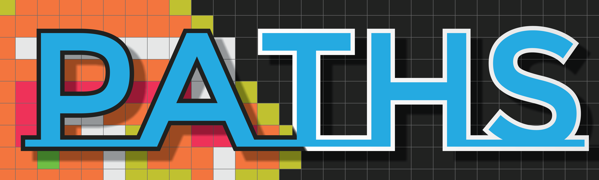

<p align="center">
  
</p>

Watch pathfinding algorithms work, cell by cell. **[Try it](https://paths.xevion.dev)** in the browser.

Paths animates the search over a grid that stays editable while it runs. It draws every cell the
algorithm has seen, every cell it has expanded, and the path it settles on. Draw walls, drag the
endpoints, swap the algorithm mid-search, and scrub back and forth along the timeline.

Editing while it plays recomputes the search and keeps your place in the timeline, so you can watch
a single wall reshape the path without losing where you were.

## Algorithms

| Algorithm | Notes |
|---|---|
| **A\*** | Informed. Shortest path when the heuristic fits the movement and the weight is 1x |
| **Dijkstra** | Uniform cost, no heuristic |
| **Greedy best-first** | Heuristic only, not optimal |
| **Breadth-first** | The uninformed baseline |
| **Depth-first** | Rarely sensible, always instructive |
| **Jump Point Search** | A\* with symmetry-breaking jumps on a uniform grid |

A\*, Dijkstra and Greedy share an expand loop over an indexed binary heap, relaxing a cell whenever
a cheaper route to it turns up. The heuristic and 8-direction movement are toggled in the sidebar.

## Modifiers

The picker above chooses the search. Everything else in the Search section modifies that choice, and
a modifier with no version for the chosen search is greyed out rather than run in its place, so
picking a search always gets you that search.

| Modifier | Effect | Available for |
|---|---|---|
| **Bidirectional** | Runs the search from both ends, meeting in the middle. Two frontiers each cover less ground than one crossing the whole distance | Dijkstra |
| **Incremental** | D\* Lite. Repairs the standing plan as you edit rather than starting over | Dijkstra |
| **Diagonal** | Lets the search step between diagonal neighbours | Everything but JPS, which is 8-connected by design |
| **Heuristic** | Which distance estimate to steer by | A\*, Greedy |
| **Weight** | Scales the estimate, trading optimality for speed above 1x | A\* |

Both switches are Dijkstra-only for now because that is the version that exists: the two-ended search
here is Dijkstra from both ends, and its stopping rule is only sound where the estimate is zero, while
D\* Lite settles the same cells a Dijkstra would whatever estimate it is handed. JPS reads nothing from
the heuristic picker or the diagonal toggle, being octile-scored and 8-connected by construction, and
Greedy orders by the estimate and nothing else, so scaling it with the weight slider reorders nothing.
Hovering a greyed control says which of these is the reason.

Pick the heuristic to match the movement. Manhattan counts a diagonal step as two when it really
costs about 1.41, so with 8-direction movement on it overestimates and A\* stops finding the
shortest path. Octile is the one that prices 8-direction movement exactly; Euclidean and Chebyshev
stay honest there too, by aiming lower. Dijkstra uses no heuristic at all, so it is never affected.

## Generators

| Generator | Layout |
|---|---|
| **Empty** | Open grid, walls are yours to draw |
| **Random** | Scattered walls to a target density |
| **Rooms** | Rectangular rooms, linked by corridors |
| **Walk** | A drunkard walk carving one winding cave |

Rooms and Walk carve out of a solid grid, so density reads as how much wall to leave behind. Both
keep their open space in one connected region, so a path always exists. The seed is the whole input.
Reuse it and the same layout comes back.

## Terrain

Walls are not the only thing a route has to reckon with. Cells can be painted with terrain that
costs more or less to cross, and the search prices it rather than just avoiding it.

| Brush | Cost to enter |
|---|---|
| **Wall** | Impassable |
| **Road** | 0.5x |
| **Mud** | 2x |
| **Water** | 4x |

Paint with the same click and drag as walls, and click a cell again to clear it back to plain. Road
is the interesting one: a heuristic counts cells and assumes each is worth at least one, so anything
cheaper than that has to be accounted for or A\* overestimates what is left and settles for a route
it should have looked past. The estimate is scaled by the cheapest weight on the grid to keep it
honest.

## Replanning as you edit

Every other search here throws its work away the moment a wall moves. D\* Lite, behind the sidebar's
**Incremental** switch, does not. It searches backward from the goal, so what it works out is each
cell's cost to reach the goal, and an edit only invalidates the cells around it. Everything else
keeps the answer it already had.

Repairing after one edit costs somewhere between a sixth and a sixteenth of solving again, and the
gap widens with the grid. It is not free: the first plan settles every reachable cell instead of
stopping at the goal, so it costs about eight times a plain A\* solve and takes roughly eight edits
to pay that back. Draw one wall and it was the wrong tool. Drag a brush across the board and it is
well ahead. The numbers are in `bench/RESULTS.md`.

Moving the start is repaired through. Moving the goal is not, because the whole field is measured
from it, so that one plans again from scratch.

Not every search reads terrain. Greedy orders by the estimate alone, breadth-first and depth-first
pick by when a cell turned up, and JPS bakes uniform step costs into the rules it skips cells by.
Choose one of those with terrain on the grid and the sidebar says so.

## Controls

| | |
|---|---|
| **Space** | Play / pause |
| **Click + drag** | Draw with the selected brush |
| **1 - 4** | Wall / road / mud / water |
| **Drag green / red** | Move the start / end |
| **Drag the timeline** | Scrub the search |
| **Scroll** | Zoom |
| **Right / middle drag** | Pan |
| **- / =** | Shrink / grow the grid |
| **Tab** | Move focus between controls |
| **Esc** | Close the settings dialog |

The sidebar holds the search, grid and playback settings; the cog opens app-level preferences, a
shortcut reference and an about page. Display toggles cover grid lines, cell animation, the
statistics readout, a g-cost distance heatmap, and three grid themes.

## Running

Built on **Unity 2020.3.18f1**. The `Makefile` builds and runs without opening the editor. Point
`UNITY` at your editor binary in a `local.mk` first:

```sh
make demo    # build the desktop player if stale, then run it
make web     # build the WebGL demo and serve it at localhost:8000
make test      # the core test suite, no editor needed
make test-play # the interface tests, which need the editor
make compile   # compile and import only, no build
```

`make web` produces the deployable build under `Build/WebGL`, which is what runs at
[paths.xevion.dev](https://paths.xevion.dev). It ships gzipped and expects the host to say so, with
the rules in `_headers` alongside it. Dropping that folder on a host that reads them is the whole
deploy.

## Roadmap

- Algorithms
    - [x] Dijkstra
    - [x] Depth-First Search
    - [x] Breadth-First Search
    - [x] Jump Point Search
    - [x] Bidirectional search
    - [ ] IDA\*
    - [ ] Orthogonal Jump Point Search
    - [ ] Trace
    - [ ] Bellman-Ford
    - [x] D\* or D\*-Lite
- Configuration Options
    - Search Options
        - [x] Uninformed (BFS / DFS / Dijkstra)
        - [x] Informed (A\* / Greedy / JPS)
        - [x] Heuristic weighting
        - Heuristics
            - [x] Manhattan
            - [x] Euclidean
            - [x] Chebyshev
            - [x] Octile
        - [x] Weighted terrain
- Level Generation
    - [x] Random placement
    - [x] Room carving
    - [x] Drunkard walk
    - [ ] Maze generation with guaranteed solutions
- Application Elements
    - [x] UI Toolbar / Tool Selection
    - [x] Algorithm Configuration Area
    - [x] Statistics Report
    - [x] Distance heatmap
    - [x] WebGL build
- Miscellaneous
    - [x] Repository graphics

## License

[GPL-3.0](LICENSE)
